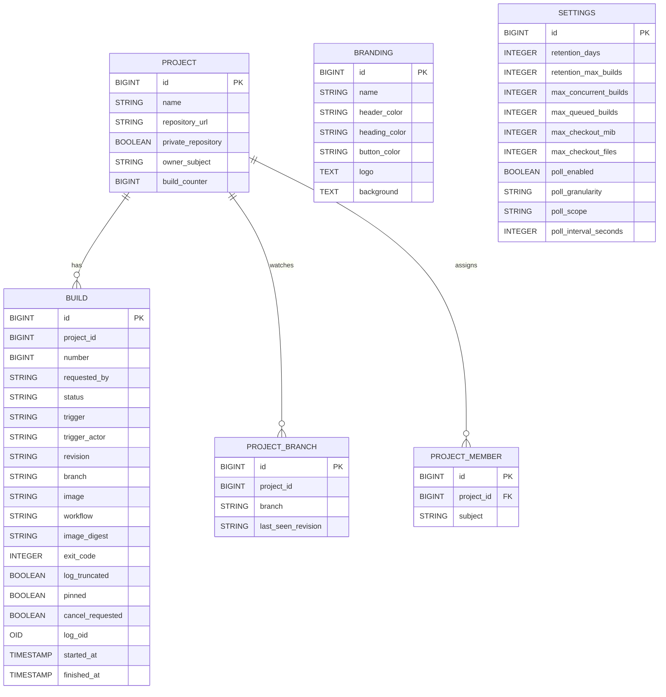

# Entity diagram

The entities are defined in `src/backend/main/java/ai/mnemosyne/cisys`. The schema is managed by Flyway migrations in `src/backend/main/resources/db/migration`, and Hibernate validates the entities against it (`quarkus.hibernate-orm.schema-management.strategy=validate`).

* `PROJECT.owner_subject` and `BUILD.requested_by` hold the Keycloak subject (`sub`) of the user.
* `BUILD.project_id` is a plain column, not a foreign key constraint.
* `BUILD.number` is unique within a project and taken from `PROJECT.build_counter`, which never goes back.
* `BUILD.logoid` (type `lo`, from the `lo` extension) references the build log, stored as one PostgreSQL large object. It is not mapped in the `Build` entity. The `lo_manage` trigger unlinks the large object when the build is deleted, so no logs are orphaned.
* `BUILD.status` is `QUEUED`, `RUNNING`, `PASSED`, `FAILED` or `CANCELLED`. `BUILD.cancel_requested` is set on a running build until the runner has stopped it.
* `BUILD.trigger` is `MANUAL` or `POLL`; a poll build stores the actor `poll` in `trigger_actor`. A unique partial index keeps at most one build per `(project_id, revision)` for poll builds, whatever branch reached the commit and across restarts; manual builds may share a commit.
* `PROJECT_BRANCH` is the automatic-build cursor: the last commit cisys queued for each watched branch. A missing row makes the branch seed its tip on the next poll without building anything. The row is removed when the branch disappears, its tip loses the workflow file, or automatic builds are turned off.
* `SETTINGS.poll_enabled` (default true), `poll_granularity` (`PER_COMMIT` or `TIP`), `poll_scope` (`WORKFLOW` or `MAIN_ONLY`) and `poll_interval_seconds` (null uses `cisys.poll.every`) hold the global automatic-build settings.
* `BRANDING` and `SETTINGS` are singleton rows with `id = 1`. Until `SETTINGS` is first saved, its defaults apply.
* `PROJECT_MEMBER.subject` is the Keycloak subject of a user assigned to the project; a subject is assigned once per project, and the rows are deleted with the project.
* Users, roles and credentials live in Keycloak and are not stored in the cisys database. The Users page changes them through the Keycloak Admin REST API.
