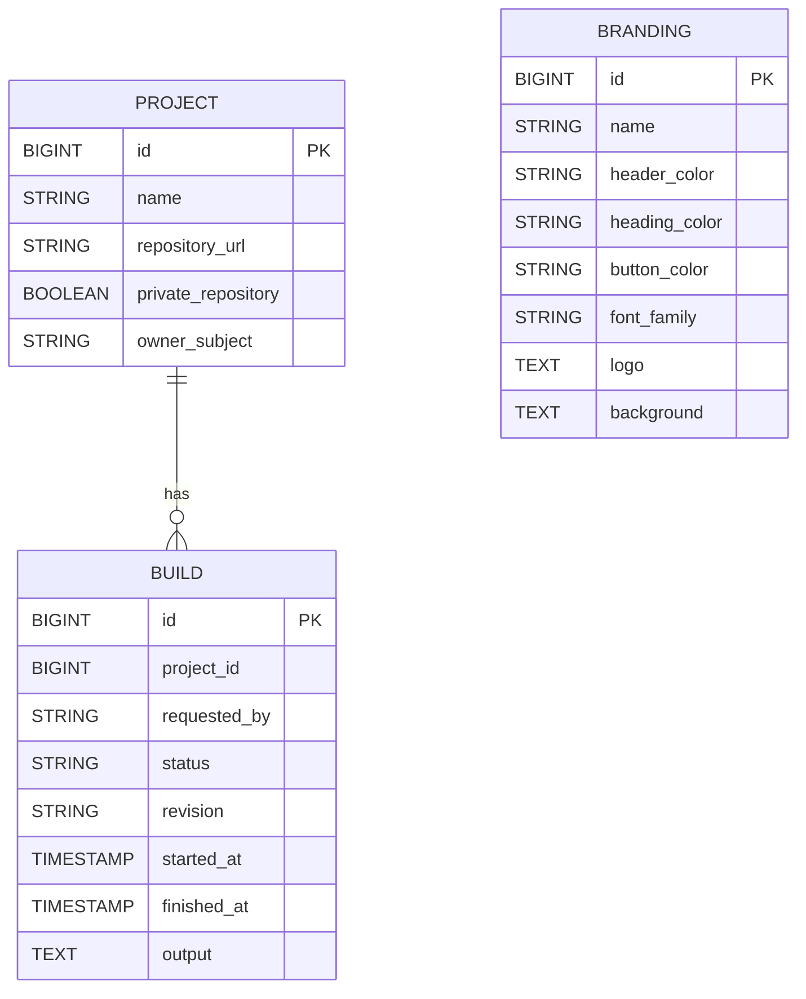

# Entity diagram

The entities are defined in `src/backend/main/java/ai/mnemosyne/cisys`. The schema is generated by Hibernate (`quarkus.hibernate-orm.schema-management.strategy=update`); there are no migrations yet.

* `PROJECT.owner_subject` and `BUILD.requested_by` hold the Keycloak subject (`sub`) of the user.
* `BUILD.project_id` is a plain column, not a foreign key constraint.
* `BUILD.status` is `RUNNING`, `PASSED` or `FAILED`.
* `BRANDING` is a singleton row with `id = 1`.
* Users, roles and credentials live in Keycloak and are not stored in the cisys database.
