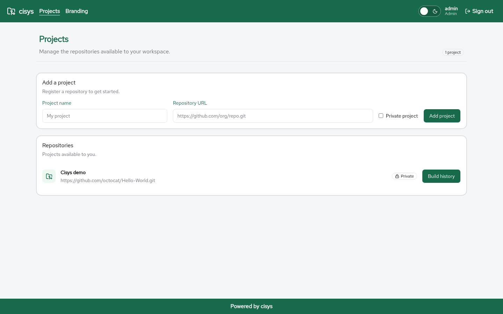

\newpage

# Getting started

This chapter describes how to prepare a local development setup for [**cisys**](https://github.com/mnemosyne-systems/cisys) using Docker Compose (PostgreSQL and Keycloak) and how to start the application in development mode.

## Requirements

Before you begin, make sure the following tools are available:

* [Java](https://openjdk.org/) 25 or newer
* [Maven](https://maven.apache.org/)
* [Node.js 26 and npm](https://nodejs.org/)
* [Docker Compose](https://docs.docker.com/compose/) or [Podman](https://podman.io/) with Compose
* [Git](https://git-scm.com/)

Container images and dependencies must be downloadable. This setup is for a trusted local machine only.

## Get the source code

Clone the repository and enter the project directory:

```sh
git clone https://github.com/mnemosyne-systems/cisys.git
cd cisys
```

## Start support services

Start PostgreSQL and Keycloak:

```sh
docker compose up -d
```

(or `podman compose up -d`). Wait for Keycloak to become available at <http://localhost:8180>.

The default local configuration expects a PostgreSQL database named `cisys` with user `cisys` and password `cisys`. These defaults can be changed through the `DB_URL`, `DB_USER` and `DB_PASSWORD` environment variables.

The Keycloak realm is imported on the first startup only; existing Keycloak data is not overwritten. To recreate the local development data, run `make reset`. This deletes the local databases.

## Start the backend

Start the backend in Quarkus development mode:

```sh
mvn quarkus:dev
```

On startup, cisys connects to PostgreSQL and updates the schema. The backend listens on
<http://localhost:8080>.

## Start the frontend

Once, after extracting an archive, run `git init` in the project directory to enable the Husky hooks. Then, in a second terminal:

```sh
cd src/frontend
npm install
npm run dev
```

Open <http://localhost:5173>.

## First login

The development realm contains the following accounts:

* Member: `member` / `member`
* Lead: `lead` / `lead`
* Admin: `admin` / `admin`

The Keycloak admin console is at <http://localhost:8180/admin> with `admin` / `admin`.

{ width=100% }

## Windows

Install Docker Desktop with its WSL 2 backend and Ubuntu. Put the project in your Ubuntu home directory, install Java, Maven, Node.js 26 and npm inside Ubuntu, and follow the steps above from an Ubuntu terminal. Open
<http://localhost:5173> in your Windows browser.
