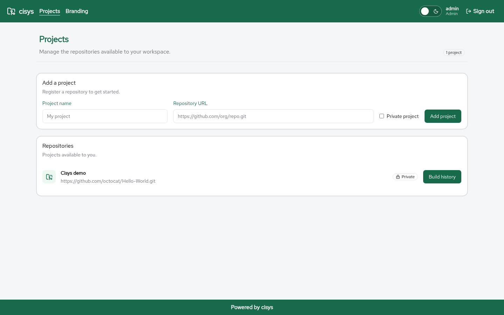
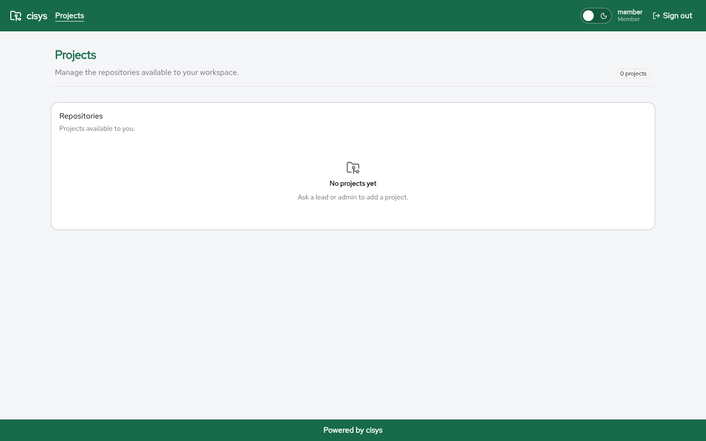

\newpage

# Projects

A **project** registers a Git repository with cisys so that it can be built.

{ width=100% }

## Visibility

* **Public** projects are visible to every signed-in user.
* **Private** projects are visible only to their creator and to admins.

The private flag controls visibility of the project and its build logs inside cisys. It does not grant or restrict access to the Git repository itself.

{ width=100% }

## Public project page

Every public project has a page at `/<name>/`, for example `http://localhost:5173/cisys/`. It shows the repository branches in a panel on the left and the build history in a table on the right, newest first. Anonymous visitors can read it.

Selecting a branch in the left panel filters the build history to that branch. The page starts on `main`, or `master` for repositories that still use it. Each build row shows a green thumbs up for a passing build, a red thumbs down for a failing build, and a spinner while it runs, followed by the build number, branch, commit, start time, duration and exit code.

Selecting a build opens its own page at `/<name>/<branch>/build/<id>`, for example `http://localhost:5173/cisys/master/build/51`, with the build details and the full log.

Private projects do not have a public page; they are reported as not found. Sign in as their owner or an admin to see their builds.

## Create a project

Leads and admins can create projects. Enter

* **Name**: up to 100 characters
* **Repository URL**: an HTTPS URL without embedded credentials, up to 2048 characters
* **Private**: whether the project is private

The creator's Keycloak subject is stored as the owner.

Registering a project accepts any HTTPS host, but builds currently accept only `github.com` and `gitlab.com` URLs; see the **Builds** chapter.

## Ownership

Ownership uses the immutable Keycloak subject ID, not the user name. Development projects created before subject-based ownership was introduced must be reset or migrated to Keycloak subject IDs.
