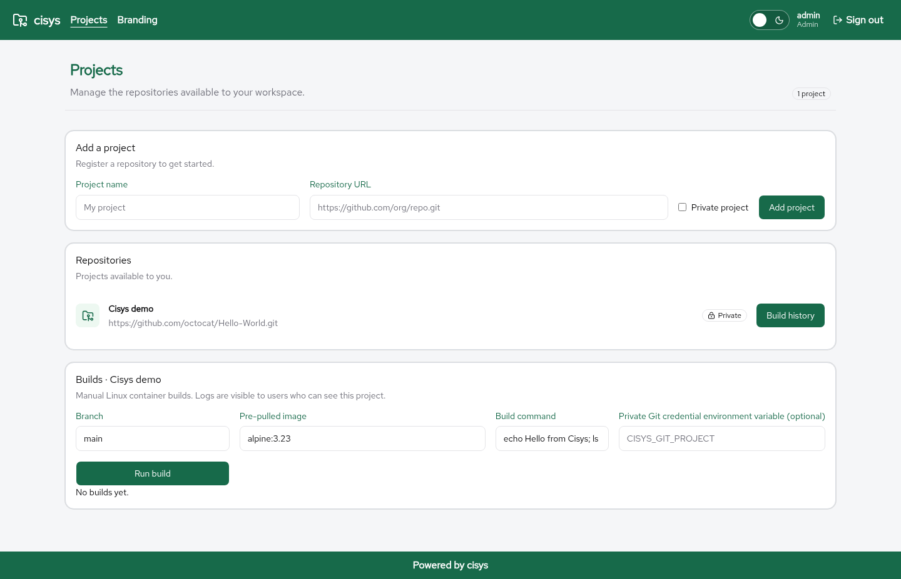

\newpage

# Builds

A **build** fetches a branch of a project's repository and runs a command inside a disposable container on the backend host.

{ width=100% }

## Start a build

Leads and admins open **Build history** on a visible project and start a manual build by entering

* **Branch**: the branch to fetch
* **Image**: one of the images an admin has allowed on the **Images** page
* **Command**: the shell command to run
* **Credential reference** (admins only, optional): see below

Members can view build history and logs for the projects they can access. Private projects and their logs are visible only to their creator and admins.

## How a build runs

1. The branch is fetched afresh with JGit at depth 1, so a force push is reflected in the next build.
2. The commit ID is recorded.
3. The checkout, without its `.git` directory, is copied into a container created without networking, with all capabilities dropped, `no-new-privileges`, a PID limit of 256, 1 GiB of memory and one CPU, running as the unprivileged user `65534:65534`.
4. The command runs in a writable copy of the checkout under `/tmp/build`.
5. The status is `PASSED` when the exit code is 0, otherwise `FAILED`. A build that exceeds ten minutes is killed and reported as timed out.

Only one build runs at a time; starting another returns "Runner busy". Output is retained up to 120 KB and truncated beyond that. Build status and output are stored in the database. If the server restarts during a build, that build is marked `FAILED`.

## Repository URLs

Only `github.com` and `gitlab.com` HTTPS URLs are accepted for builds. Redirects, embedded credentials, query strings, fragments and non-default ports are rejected.

## Private Git repositories

Set an environment variable whose name starts with `CISYS_GIT_`, for example `CISYS_GIT_PROJECT`, to a read-only provider token in the backend environment before starting it. Then, as an admin, enter that variable name in the build form.

* The value is never stored in the project database and is not passed to the build container.
* Only admins can use credential references until credentials are scoped to individual projects.
* Never include secrets in build commands or output.

## Images

Admins manage build images under **Images** in the header. The page lists the images present in the container runtime on the backend host, with their ID, size and age.

* **Pull** downloads an image from its registry, for example `docker.io/library/alpine:3.23`.
* **Remove** deletes a local image and takes it off the allowed list.
* Tick the images that builds may use and select **Save**. Only those images appear in the build form, and the backend rejects any other image.

An image that is allowed but no longer present locally is listed separately, where it can be pulled again or cleared.

## Container runtime

The runner is always on. It uses Podman when it is installed and Docker otherwise.

**Trust boundary:** the runner allows trusted leads and admins to execute code through the local container daemon. Docker socket access grants host-level control to the backend. These limits are not a hostile-code sandbox. Use a dedicated machine, disk quotas and trusted repositories, and do not expose this setup to the Internet. Repository checkout sizes are not bounded.

## Verification status

The build path was verified with Docker on Linux, including a public repository fetched with JGit and an Alpine container. It has not been verified end-to-end with a real private Git provider, Podman, or Windows/WSL.
