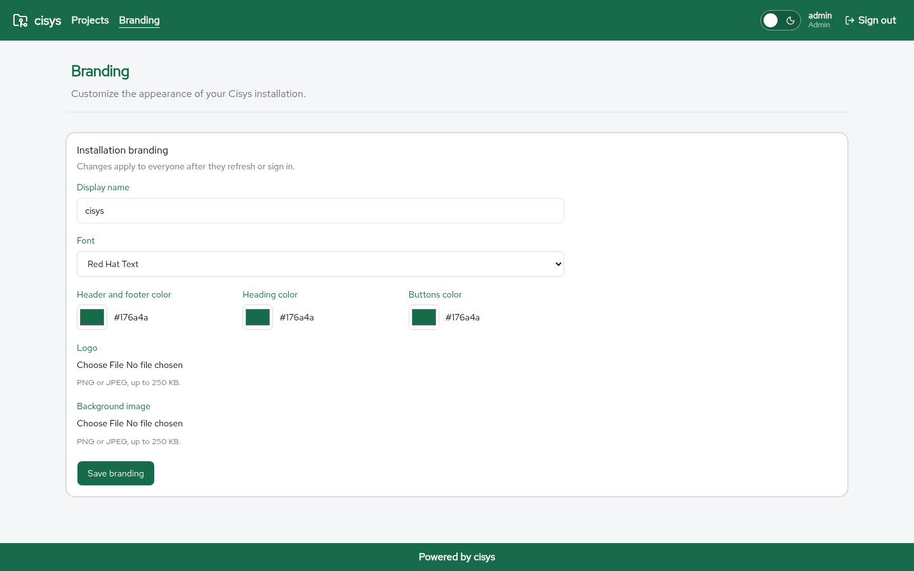

\newpage

# Branding

**Branding** changes how the installation looks. Only an Admin can save branding; every signed-in user sees the result after refreshing.

{ width=100% }

## Open the settings

Sign in as an Admin and select **Branding** in the header.

## Settings

* **Display name**: up to 80 characters
* **Font**: Red Hat Text (the default) or the system sans-serif font
* **Header and footer color**
* **Heading color**
* **Button color**
* **Logo**
* **Background image**

Colors are `#RRGGBB` values. The logo and background must be PNG or JPEG images no larger than 250 KB.

## Notes

* Branding is stored in the database as a single record.
* The Keycloak-hosted sign-in page is not customized by these settings.
* Light and dark mode is chosen per user in the header and is remembered by the browser.
